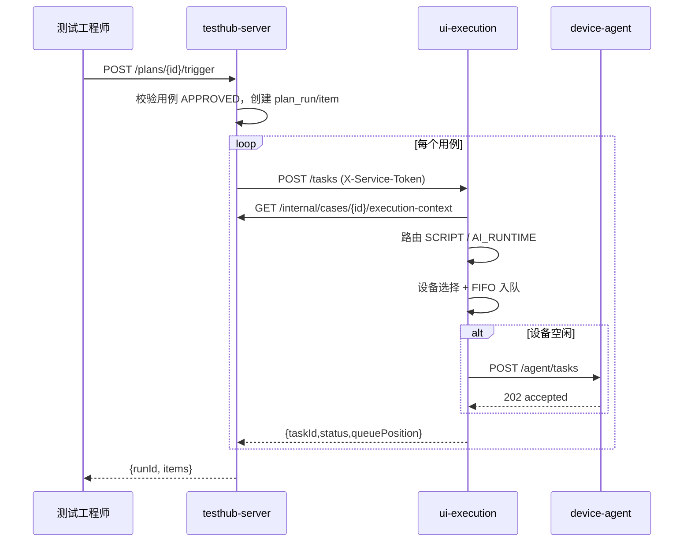
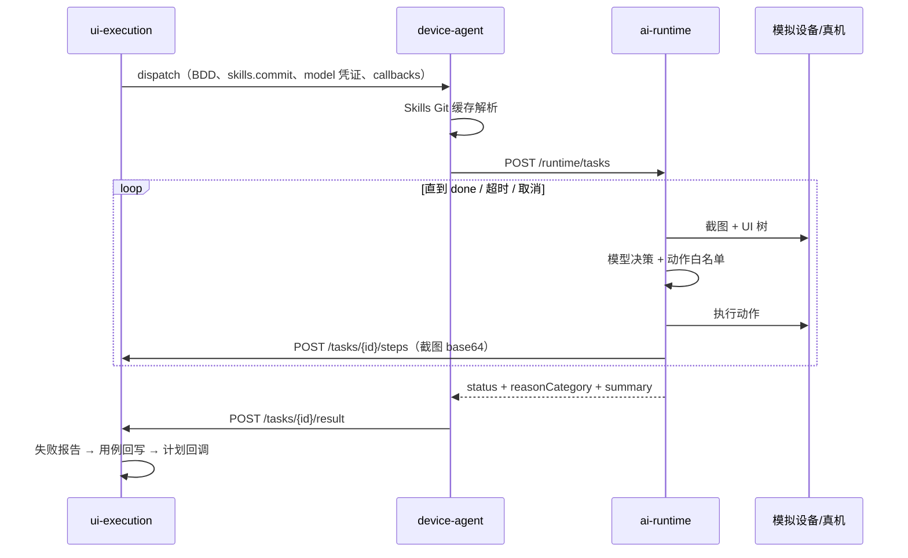

# TestHub V1 实现架构

> 本文描述 **V1 实际实现**的架构，与《TestHub 架构设计文档》的对应关系和偏差见 `docs/V1-SCOPE.md`。

## 1. 部署视图

```
                        ┌─────────────────────────────┐
                        │   web（React 控制台 :5173）  │
                        └──────────┬──────────────────┘
                                   │ JWT / HTTP
        ┌──────────────────────────┴──────────────────────────┐
        ▼                                                     ▼
┌───────────────────────┐                        ┌────────────────────────────┐
│  testhub-server :8080 │◄── X-Service-Token ───►│  ui-execution :8081        │
│  case-management      │   /internal/**          │  执行器路由 / 设备 FIFO     │
│  test-plan            │                        │  状态机 / 轨迹 / 失败报告   │
│  system-setting       │                        │  Skills 指针                │
│  ai-analysis          │                        │                            │
└───────────────────────┘                        └──────────┬─────────────────┘
                                                            │ 下发 / 取消
                                                            │ HTTP + X-Agent-Token
                                         ┌──────────────────▼──────────────────┐
                                         │  device-agent :8090                  │
                                         │  注册/心跳 · 模拟设备 · ADB（可选）   │
                                         │  传统脚本执行器 · Skills Git 缓存     │
                                         └──────────────────┬──────────────────┘
                                                            │ 本地 HTTP
                                                            ▼
                                         ┌─────────────────────────────────────┐
                                         │  ai-runtime :8095（Python）          │
                                         │  截图+UI树 → 模型决策 → 动作 → 轨迹   │
                                         └─────────────────────────────────────┘
```

中心编排层与设备执行层之间是 **HTTP 执行通道**，与 Sonic 的设备 WebSocket 通道（投屏/心跳）分离；
V1 未实现投屏，设备状态由 Agent 心跳同步。

## 2. 服务与模块边界

### testhub-server（主服务器，模块化单体）

| 模块包 | 职责 | 未来拆分 |
|---|---|---|
| `auth` | 登录、用户、角色 | system-setting |
| `system` | 模型配置（文本/视觉）、审计 | system-setting |
| `requirement` | 测试需求 | test-track |
| `casemgmt` | 客户端前端用例、评审、能力计算、失败分析 | case-management |
| `script` | 脚本工程包、下载票据 | case-management |
| `plan` | 测试计划、运行、统一报告、对账 | test-plan |
| `ai` | BDD 生成 Agent、Provider 抽象 | ai-analysis |
| `internal` | 服务间接口 | — |

模块之间只通过 Service 接口与 DTO 交互，不共享 Repository；`plan` 调 `ui-execution` 走 HTTP，符合架构文档的
「对上游暴露创建任务接口」设计。拆分为独立服务时替换进程内调用即可。

### ui-execution（独立服务）

| 模块包 | 职责 |
|---|---|
| `agent` | Agent 注册、心跳、离线判定 |
| `device` | 设备同步、状态计算、选设备、队列视图 |
| `queue` | `DeviceQueueStore` 端口：内存实现 / Redis 实现 |
| `task` | 创建、路由、下发、取消、状态机、看门狗 |
| `events` | 任务生命周期事件：本地日志 / Kafka（dispatch、result） |
| `trace` | 步骤、截图、日志、SSE |
| `report` | 失败轨迹报告生成与存储 |
| `skills` | 全局指针、同步（git ls-remote）、回滚、审计 |
| `artifact` | `ArtifactStore` 端口：本地文件 / MinIO |
| `integration` | CoreClient、AgentClient、事件回调 |

### device-agent / ai-runtime

Agent 负责「设备」与「执行器进程」；AI Runtime 只负责「决策循环」。
两者通过本地 HTTP 解耦，Runtime 崩溃或升级不影响 Agent 的设备管理。

## 3. 关键流程时序

### 3.1 计划触发与路由



### 3.2 AI Runtime 执行与轨迹



### 3.3 失败后处理

```
终止态（FAILED/TIMEOUT/CANCELLED）
  → 汇总 steps + artifacts 生成 failure-report.json（含 environment/timeline）
  → 上传 ArtifactStore，得到 reportUrl
  → PUT core /internal/cases/{id}/failure-analysis（独立字段）
  → POST core /internal/plan-runs/items/result（幂等）
  → 释放设备 → 出队下一个任务
```

## 4. 数据模型（V1）

### core（`testhub_core`）

| 表 | 关键字段 |
|---|---|
| `app_user` | id, username, password_hash, display_name, role, enabled |
| `model_config` | id, config_type, provider, endpoint, api_key_enc, model_id |
| `audit_log` | id, actor, action, target, detail, created_at |
| `req_item` | id, title, description |
| `client_case` | id, title, bdd_given/when/then, requirement_id, review_status, source, model_id, script_id, failure_analysis, failure_report_url |
| `case_review` | id, case_id, action, actor, comment |
| `script_project` | id, name, script_type, entry_command, object_key, size_bytes |
| `test_plan` / `plan_case` | 计划与挂载（executor_type_override） |
| `plan_run` / `plan_run_item` | 运行与逐用例结果（task_id、failure_reason、report_url） |
| `ai_job` | id, requirement_id, model_id, prompt_version, status, output_case_ids |

### ui-execution（`testhub_uiexec`）

| 表 | 关键字段 |
|---|---|
| `ue_agent` | id, name, host, base_url, last_heartbeat |
| `ue_device` | id, agent_id, serial, name, model, platform, tags, online |
| `ue_task` | id, plan_run_id, case_id, executor_type, status, device_id, skills_commit, failure_*、时间戳 |
| `ue_step` | id, task_id, seq, status, decision, action, elapsed_ms, screenshot_url |
| `ue_log` | id, task_id, seq, level, message |
| `ue_failure_report` | id, task_id, report_url, reason_category, summary |
| `ue_skills_pointer` | 单行：git_url, branch, active_commit |
| `ue_audit_log` | 审计 |

队列在 Redis（或内存）中：`ueexec:device:{deviceId}:queue`，元素为 taskId；位置由列表索引计算。
截图与报告按 `taskId/` 组织存放于 ArtifactStore；`/artifacts/**` 控制器统一从 ArtifactStore 流式读取，
因此本地文件与 MinIO 使用同一组 URL（已在真实 MinIO 上验收）。

## 5. 状态机

```
PENDING ──dispatch──► DISPATCHED ──first step──► RUNNING ──► SUCCESS
   │                      │                         ├──────► FAILED
   ├──cancel──► CANCELLED │                         ├──────► TIMEOUT（看门狗）
   └──no device──► FAILED │                         └──────► CANCELLED（Agent 确认）
                          └──dispatch failed──► FAILED(EXECUTOR_UNAVAILABLE)
```

计划运行：`RUNNING → COMPLETED | PARTIAL | FAILED`（按 item 汇总）。

## 6. 安全模型

- 用户：JWT（HS256，12h），`@RequireRole` 默认拒绝；`@PublicApi` 仅登录/健康/票据下载。
- 服务间：`X-Service-Token`，且 common 拦截器要求调用者身份必须是 service principal。
- Agent：`X-Agent-Token`；Agent 回调端点额外显式校验，避免 JWT 越权。
- 模型密钥：AES-256-GCM 加密落库；仅 `/internal` 下发短期凭证（15 分钟）；Runtime 不持久化。
- 审计：模型配置、评审、计划触发、Skills 指针、任务取消、Agent 注册。
- V1 已知例外：`/artifacts/**` 随机路径公开访问（见 RUNBOOK 上线清单）。

## 7. 扩展点

| 扩展点 | 端口/接口 | 下一步 |
|---|---|---|
| 消息总线 | `TaskEventPublisher`：local 结构化日志 / Kafka 事件流 | 已发布 `ui-execution.task.dispatch`、`ui-execution.task.result`；下一步把任务下发迁到 Kafka |
| 队列 | `DeviceQueueStore` | Redis 实现已提供；多副本时需分布式锁/消费组 |
| 产物 | `ArtifactStore` | MinIO 实现已提供；可换 S3/OSS |
| 模型 | `TextModelProvider` / `VisionProvider` | 新增 Provider 即接入新模型 |
| 执行器 | `ExecutorType` + Agent 执行器路由 | 新增执行器类型（如 API/性能） |
| 设备驱动 | `DeviceDriver` | 真机 ADB / scrcpy 投屏通道 |
| Skills | Git 指针 + Agent 缓存 | 支持私有仓库凭证注入与审计 |

## 8. 可观测性（V1）

- 统一 `taskId` 贯穿日志、产物路径、失败报告与计划 item。
- `/actuator/health`、`/actuator/metrics`（Spring Boot Actuator）+ `/api/v1/ui-execution/stats` 聚合指标。
- 任务详情提供逐步轨迹与实时日志；SSE 端点供控制台/外部系统订阅。
- 审计日志可查询（core 与 ui-execution）。
